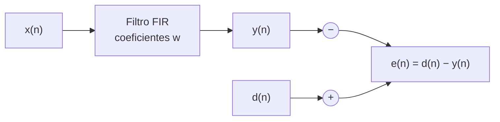
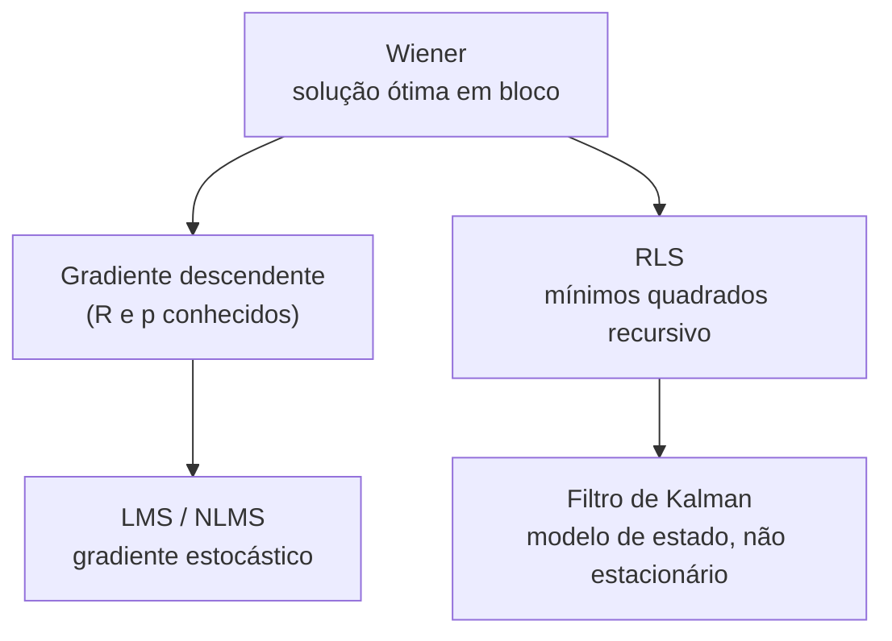

# Aula 1 — O Filtro de Wiener: o alvo dos filtros adaptativos

**Curso:** Introdução aos Filtros Adaptativos
**Duração sugerida:** 100 min (2 × 50 min)
**Pré-requisitos:** estatística descritiva, correlação, álgebra linear básica (autovalores), convolução discreta
**Ferramentas:** MATLAB R2023b ou mais recente, com *Signal Processing Toolbox* (`xcorr`, `toeplitz`) e *DSP System Toolbox* (usada na próxima aula, `dsp.LMSFilter`)

---

## Sumário

1. [Objetivos de aprendizagem](#1-objetivos-de-aprendizagem)
2. [Motivação: duas aplicações](#2-motivação-duas-aplicações)
3. [Formulação do problema](#3-formulação-do-problema)
4. [Derivação da solução de Wiener](#4-derivação-da-solução-de-wiener)
5. [A superfície de erro](#5-a-superfície-de-erro)
6. [Prática 1 — Identificação de sistema](#6-prática-1--identificação-de-sistema)
7. [Prática 2 — Superfície de erro e condicionamento](#7-prática-2--superfície-de-erro-e-condicionamento)
8. [Prática 3 — Cancelamento de interferência](#8-prática-3--cancelamento-de-interferência)
9. [Limitações e a ponte para o restante do curso](#9-limitações-e-a-ponte-para-o-restante-do-curso)
10. [Exercícios propostos](#10-exercícios-propostos)
11. [Referências](#11-referências)

---

## 1. Objetivos de aprendizagem

Ao final da aula, o aluno deverá ser capaz de:

- formular o problema de filtragem ótima como minimização do erro quadrático médio (EQM);
- deduzir as **equações normais de Wiener–Hopf** na forma matricial, $\mathbf{R}\mathbf{w}_o = \mathbf{p}$;
- enunciar e interpretar o **princípio da ortogonalidade**;
- descrever a superfície de erro como um paraboloide e relacionar sua forma aos **autovalores** de $\mathbf{R}$;
- estimar $\mathbf{R}$ e $\mathbf{p}$ a partir de dados e calcular o filtro de Wiener no MATLAB;
- explicar por que o filtro de Wiener **não é adaptativo** e como isso motiva LMS, RLS e Kalman.

---

## 2. Motivação: duas aplicações

Em ambas, existe um sinal **desejado** $d(n)$ e um sinal de **entrada** $x(n)$ correlacionados de algum modo desconhecido. Queremos um filtro que, aplicado a $x(n)$, reproduza $d(n)$ da melhor forma possível.

| Aplicação | $x(n)$ | $d(n)$ | O que o filtro aprende |
|---|---|---|---|
| Identificação de sistema | excitação aplicada à planta | saída medida da planta | resposta ao impulso da planta |
| Cancelamento de interferência | referência da interferência | sinal do sensor (sinal útil + interferência) | caminho da interferência até o sensor |

Na segunda aplicação, o erro $e(n) = d(n) - y(n)$ é justamente o **sinal útil** recuperado.



---

## 3. Formulação do problema

Considere um filtro FIR de $L$ coeficientes $w_0, \dots, w_{L-1}$. Defina o vetor de regressão e o vetor de coeficientes:

$$
\mathbf{x}(n) = \begin{bmatrix} x(n) & x(n-1) & \cdots & x(n-L+1) \end{bmatrix}^{\mathsf T},
\qquad
\mathbf{w} = \begin{bmatrix} w_0 & w_1 & \cdots & w_{L-1} \end{bmatrix}^{\mathsf T}.
$$

A saída e o erro são

$$
y(n) = \mathbf{w}^{\mathsf T}\mathbf{x}(n), \qquad e(n) = d(n) - y(n).
$$

**Hipóteses desta aula** (importantes, pois delimitam onde o resultado vale):

1. $x(n)$ e $d(n)$ são processos **estacionários no sentido amplo**, de média nula;
2. são **conjuntamente** estacionários;
3. as estatísticas de segunda ordem (correlações) são **conhecidas** (ou estimáveis a partir de dados);
4. o filtro é **linear** e o critério é o **erro quadrático médio**.

O critério de projeto é

$$
J(\mathbf{w}) = \mathbb{E}\left[e^2(n)\right].
$$

---

## 4. Derivação da solução de Wiener

### 4.1 Expansão do custo

Substituindo $e(n) = d(n) - \mathbf{w}^{\mathsf T}\mathbf{x}(n)$:

$$
J(\mathbf{w}) = \mathbb{E}[d^2(n)] - 2\,\mathbf{w}^{\mathsf T}\mathbb{E}[d(n)\mathbf{x}(n)] + \mathbf{w}^{\mathsf T}\mathbb{E}[\mathbf{x}(n)\mathbf{x}^{\mathsf T}(n)]\,\mathbf{w}.
$$

Definindo

$$
\sigma_d^2 = \mathbb{E}[d^2(n)], \qquad
\mathbf{p} = \mathbb{E}[d(n)\,\mathbf{x}(n)], \qquad
\mathbf{R} = \mathbb{E}[\mathbf{x}(n)\,\mathbf{x}^{\mathsf T}(n)],
$$

obtemos uma **forma quadrática** nos coeficientes:

$$
\boxed{J(\mathbf{w}) = \sigma_d^2 - 2\,\mathbf{p}^{\mathsf T}\mathbf{w} + \mathbf{w}^{\mathsf T}\mathbf{R}\,\mathbf{w}}
$$

Sendo $r_x(k) = \mathbb{E}[x(n)x(n-k)]$ e $r_{dx}(k) = \mathbb{E}[d(n)x(n-k)]$, a matriz $\mathbf{R}$ é **simétrica de Toeplitz** e o vetor $\mathbf{p}$ é uma amostra da correlação cruzada:

$$
\mathbf{R} =
\begin{bmatrix}
r_x(0) & r_x(1) & \cdots & r_x(L-1)\\
r_x(1) & r_x(0) & \cdots & r_x(L-2)\\
\vdots & & \ddots & \vdots\\
r_x(L-1) & r_x(L-2) & \cdots & r_x(0)
\end{bmatrix},
\qquad
\mathbf{p} =
\begin{bmatrix} r_{dx}(0) \\ r_{dx}(1) \\ \vdots \\ r_{dx}(L-1) \end{bmatrix}.
$$

### 4.2 Minimização

O gradiente e a Hessiana de $J$ são

$$
\nabla_{\mathbf{w}} J = -2\mathbf{p} + 2\mathbf{R}\mathbf{w}, \qquad \nabla^2_{\mathbf{w}} J = 2\mathbf{R}.
$$

Como $\mathbf{R}$ é semidefinida positiva (e definida positiva se $x(n)$ não for perfeitamente previsível), $J$ é convexa e o ponto estacionário é o **mínimo global**. Igualando o gradiente a zero:

$$
\boxed{\mathbf{R}\,\mathbf{w}_o = \mathbf{p}}
\qquad\Longrightarrow\qquad
\mathbf{w}_o = \mathbf{R}^{-1}\mathbf{p}.
$$

Estas são as **equações normais de Wiener–Hopf** (versão FIR, tempo discreto).

### 4.3 Erro mínimo

Substituindo $\mathbf{w}_o$ em $J$:

$$
J_{\min} = \sigma_d^2 - \mathbf{p}^{\mathsf T}\mathbf{w}_o = \sigma_d^2 - \mathbf{p}^{\mathsf T}\mathbf{R}^{-1}\mathbf{p}.
$$

### 4.4 Princípio da ortogonalidade

A condição $\mathbf{R}\mathbf{w}_o = \mathbf{p}$ equivale a

$$
\mathbb{E}\left[\mathbf{x}(n)\,e_o(n)\right] = \mathbf{p} - \mathbf{R}\mathbf{w}_o = \mathbf{0}.
$$

> **Interpretação.** No ótimo, o erro é **ortogonal (não correlacionado) a todas as amostras da entrada** usadas pelo filtro. Se sobrasse correlação entre o erro e alguma amostra $x(n-k)$, ainda haveria informação aproveitável para reduzir o erro. Este é o mesmo princípio que sustenta a regressão linear por mínimos quadrados, que os alunos já conhecem.

---

## 5. A superfície de erro

Completando o quadrado, mostra-se que

$$
\boxed{J(\mathbf{w}) = J_{\min} + (\mathbf{w}-\mathbf{w}_o)^{\mathsf T}\,\mathbf{R}\,(\mathbf{w}-\mathbf{w}_o)}
$$

*Verificação rápida:* expandindo o lado direito e usando $\mathbf{R}\mathbf{w}_o = \mathbf{p}$ e $J_{\min} = \sigma_d^2 - \mathbf{p}^{\mathsf T}\mathbf{w}_o$, recupera-se a expressão da seção 4.1.

Com a decomposição espectral $\mathbf{R} = \mathbf{Q}\boldsymbol{\Lambda}\mathbf{Q}^{\mathsf T}$ e a mudança de variáveis $\mathbf{v} = \mathbf{Q}^{\mathsf T}(\mathbf{w}-\mathbf{w}_o)$:

$$
J = J_{\min} + \sum_{i=0}^{L-1} \lambda_i\, v_i^2 .
$$

Consequências geométricas:

- as curvas de nível são **elipsoides** centradas em $\mathbf{w}_o$;
- os **eixos** dos elipsoides apontam nos autovetores de $\mathbf{R}$;
- a curvatura ao longo de cada eixo é proporcional a $\lambda_i$;
- o formato é caracterizado pela **razão de autovalores** (número de condição)

$$
\chi(\mathbf{R}) = \frac{\lambda_{\max}}{\lambda_{\min}}.
$$

> **Gancho para a próxima aula.** Entrada branca ($\mathbf{R} \propto \mathbf{I}$) dá curvas de nível circulares e $\chi = 1$. Entrada colorida dá elipses alongadas, $\chi \gg 1$, e algoritmos iterativos (LMS, gradiente descendente) ficam **lentos** na direção de menor curvatura.

---

## 6. Prática 1 — Identificação de sistema

**Cenário.** Uma planta FIR desconhecida $\mathbf{h}$ é excitada por ruído branco $x(n)$ (em V). A saída é medida com ruído aditivo de sensor. Queremos recuperar $\mathbf{h}$ pelo filtro de Wiener.

Primeiro, a função que estima $\mathbf{R}$, $\mathbf{p}$ a partir de dados e resolve as equações normais. Salve como `wienerFIR.m`:

```matlab
function [w, e, Jmin, R, p] = wienerFIR(x, d, L)
%WIENERFIR  Filtro de Wiener FIR com L coeficientes, a partir de dados.
%   x : sinal de entrada (referência)
%   d : sinal desejado
%   L : número de coeficientes
%   w : coeficientes ótimos     e : erro (d - y)
%   Jmin : EQM mínimo           R, p : estimativas de R e p
    x = x(:);  d = d(:);
    N = numel(x);

    % Matriz de dados: a linha n é [x(n) x(n-1) ... x(n-L+1)]
    X = toeplitz(x, [x(1); zeros(L-1, 1)]);

    R = (X.' * X) / N;          % estimativa de E[x x^T]
    p = (X.' * d) / N;          % estimativa de E[d x]
    w = R \ p;                  % equações normais de Wiener-Hopf

    e    = d - X * w;
    Jmin = mean(d.^2) - p.' * w;
end
```

Agora o script do experimento:

```matlab
%% Prática 1 — Identificação de sistema com o filtro de Wiener
clear; clc; close all
rng(1)                               % reprodutibilidade

fs = 8e3;                            % frequência de amostragem [Hz]
N  = 2e4;                            % número de amostras
L  = 4;                              % coeficientes do filtro

h = [0.8; -0.4; 0.2; 0.1];           % planta desconhecida (a ser identificada)
sigma_v = 0.1;                       % desvio padrão do ruído do sensor [V]

x = randn(N, 1);                     % excitação branca, variância 1 V^2
d = filter(h, 1, x) + sigma_v*randn(N, 1);

[w, e, Jmin, R, p] = wienerFIR(x, d, L);

disp(table(h, w, 'VariableNames', {'h_verdadeiro', 'w_wiener'}))
fprintf('Jmin estimado = %.4f V^2   (teórico = sigma_v^2 = %.4f V^2)\n', ...
        Jmin, sigma_v^2)
fprintf('mean(e.^2)    = %.4f V^2   (deve coincidir com Jmin)\n', mean(e.^2))

%% Verificação do princípio da ortogonalidade
X = toeplitz(x, [x(1); zeros(L-1,1)]);
disp('E[x(n) e(n)] ≈ 0 :')
disp((X.' * e / N).')
```

**O que esperar e discutir com os alunos:**

- $\mathbf{w} \approx \mathbf{h}$: com entrada branca, $\mathbf{R} \approx \mathbf{I}$ e portanto $\mathbf{w}_o = \mathbf{p} = \mathbf{h}$.
- $J_{\min} \approx \sigma_v^2$: o erro mínimo é a potência do ruído que **nenhum filtro linear de $x$** consegue explicar.
- As correlações amostrais entre o erro e cada $x(n-k)$ saem da ordem de $10^{-15}$ (zero a menos de precisão numérica), confirmando a ortogonalidade. Isso é exato para as estimativas usadas, pois $\hat{\mathbf{p}} - \hat{\mathbf{R}}\mathbf{w} = \mathbf{0}$ por construção.
- **Pergunta:** o que acontece se $L=2$ (subdimensionado)? E se $L=10$ (superdimensionado)?

### Alternativa com a *Signal Processing Toolbox*

As mesmas estimativas, via funções de correlação:

```matlab
r   = xcorr(x, L-1, 'biased');   r   = r(L:end);     % r_x(0..L-1)
rdx = xcorr(d, x, L-1, 'biased'); p2  = rdx(L:end);  % r_dx(0..L-1)

R2 = toeplitz(r);                % R é Toeplitz simétrica
w2 = R2 \ p2;

disp(table(w, w2, 'VariableNames', {'via_dados', 'via_xcorr'}))
```

Aqui a estrutura de Toeplitz de $\mathbf{R}$ fica explícita. Os resultados diferem apenas por efeitos de borda na estimativa.

---

## 7. Prática 2 — Superfície de erro e condicionamento

Agora a entrada é **colorida**: um processo AR(1), $x(n) = 0{,}9\,x(n-1) + u(n)$, com $u(n)$ branco. Usamos $L = 2$ para poder visualizar a superfície em 2D.

```matlab
%% Prática 2 — Superfície de erro: entrada branca vs. colorida
clear; clc; close all
rng(2)

N = 5e4;  L = 2;
h = [1; -0.5];

casos = {'Entrada branca', 'Entrada colorida (AR(1), a = 0,9)'};
x_all = {randn(N,1), filter(1, [1 -0.9], randn(N,1))};

figure('Position', [100 100 950 420])
tl = tiledlayout(1, 2, 'TileSpacing', 'compact');

for c = 1:2
    x = x_all{c};
    d = filter(h, 1, x) + 0.1*randn(N, 1);
    [wo, ~, Jmin, R] = wienerFIR(x, d, L);

    lambda = eig(R);
    fprintf('%s:  lambda = [%.3f  %.3f],  cond(R) = %.1f\n', ...
            casos{c}, lambda(1), lambda(2), cond(R))

    % J(w) = Jmin + (w-wo)' R (w-wo)
    [W0, W1] = meshgrid(linspace(wo(1)-1.5, wo(1)+1.5, 200), ...
                        linspace(wo(2)-1.5, wo(2)+1.5, 200));
    D0 = W0 - wo(1);  D1 = W1 - wo(2);
    J  = Jmin + R(1,1)*D0.^2 + 2*R(1,2)*D0.*D1 + R(2,2)*D1.^2;

    nexttile
    contour(W0, W1, J, 25); hold on
    plot(wo(1), wo(2), 'rp', 'MarkerFaceColor', 'r', 'MarkerSize', 10)
    axis equal; grid on
    xlabel('w_0'); ylabel('w_1')
    title(sprintf('%s\n\\chi(R) = %.1f', casos{c}, cond(R)))
end
title(tl, 'Curvas de nível de J(w) = E[e^2] [V^2]')
```

**Valores teóricos** (para conferir): com entrada branca de variância unitária, $\lambda_{1,2} = 1$ e $\chi = 1$. Para o AR(1) com $a = 0{,}9$, $\sigma_x^2 = 1/(1-a^2) \approx 5{,}26$ e $\mathbf{R} = \sigma_x^2\begin{bmatrix}1 & a\\ a & 1\end{bmatrix}$, logo

$$
\lambda_{1,2} = \sigma_x^2(1 \pm a) \approx 10{,}0 \text{ e } 0{,}53, \qquad \chi = \frac{1+a}{1-a} = 19.
$$

**Discussão:** o mínimo é o mesmo ponto ($\mathbf{w}_o = \mathbf{h}$) nos dois casos, mas a **dificuldade de chegar lá** é muito diferente. Guarde esta figura: ela reaparece na aula do LMS.

### Teaser: gradiente descendente sobre a superfície de Wiener

Se $\mathbf{R}$ e $\mathbf{p}$ fossem conhecidos, poderíamos evitar a inversão e caminhar na superfície:

$$
\mathbf{w}(k+1) = \mathbf{w}(k) + \mu\left(\mathbf{p} - \mathbf{R}\,\mathbf{w}(k)\right), \qquad 0 < \mu < \frac{2}{\lambda_{\max}}.
$$

Acrescente ao final do laço da Prática 2 (no caso colorido, $c=2$):

```matlab
    if c == 2
        mu = 0.15;                      % < 2/lambda_max ≈ 0,2
        wk = zeros(L, 1);  traj = wk;
        p  = R * wo;                    % p = R*wo (equações normais)
        for k = 1:80
            wk   = wk + mu*(p - R*wk);
            traj = [traj, wk];          %#ok<AGROW>
        end
        plot(traj(1,:), traj(2,:), 'k.-')
    end
```

A trajetória avança rápido ao longo do eixo de maior curvatura e arrasta-se no de menor curvatura. O gradiente verdadeiro exige $\mathbf{R}$ e $\mathbf{p}$; o LMS substituirá esse gradiente por uma estimativa instantânea.

---

## 8. Prática 3 — Cancelamento de interferência

**Cenário.** Um sensor mede uma grandeza de interesse $s(n)$ (senoide de 10 Hz, 1 V de amplitude) contaminada por uma interferência $v(n)$. Dispomos de uma **referência** $x(n)$ da fonte da interferência, medida em outro ponto. A interferência chega ao sensor filtrada por um caminho $\mathbf{g}$ desconhecido:

$$
d(n) = s(n) + (\mathbf{g} * x)(n).
$$

Como $s(n)$ **não é correlacionado** com $x(n)$, o filtro de Wiener só consegue explicar a parte de $d(n)$ vinda de $x(n)$. O erro $e(n)$ aproxima, portanto, $s(n)$.

```matlab
%% Prática 3 — Cancelamento de interferência
clear; clc; close all
rng(3)

fs = 1e3;  N = 5e3;  t = (0:N-1).'/fs;     % [Hz], amostras, [s]
L  = 8;

s = sin(2*pi*10*t);                        % sinal de interesse [V]
x = randn(N, 1);                           % referência da interferência [V]
g = [0.9; 0.5; -0.3; 0.2; 0.1];            % caminho desconhecido
d = s + filter(g, 1, x);                   % sinal medido pelo sensor

[w, e, Jmin] = wienerFIR(x, d, L);

SNR_antes  = 10*log10(mean(s.^2) / mean((d - s).^2));
SNR_depois = 10*log10(mean(s.^2) / mean((e - s).^2));
fprintf('SNR antes : %6.2f dB\n', SNR_antes)
fprintf('SNR depois: %6.2f dB\n', SNR_depois)
fprintf('Jmin = %.4f V^2  (potência de s = %.4f V^2)\n', Jmin, mean(s.^2))

figure('Position', [100 100 900 600])
tiledlayout(3, 1, 'TileSpacing', 'compact')
idx = t <= 0.5;

nexttile, plot(t(idx), d(idx)), grid on
ylabel('d(n) [V]'), title('Sinal medido (útil + interferência)')

nexttile, plot(t(idx), e(idx)), hold on, plot(t(idx), s(idx), '--'), grid on
ylabel('e(n) [V]'), legend('Saída do filtro de Wiener', 's(n) verdadeiro')
title('Sinal recuperado')

nexttile, stem(0:L-1, w, 'filled'), hold on
stem(0:numel(g)-1, g, 'o'), grid on
xlabel('k'), ylabel('w_k'), legend('Wiener', 'caminho g verdadeiro')
title('Coeficientes estimados')
```

**Pontos para discussão:**

- $J_{\min} \approx \sigma_s^2 = 0{,}5\ \text{V}^2$: o **erro mínimo é o próprio sinal útil**. O filtro não "apaga" o sinal porque ele é ortogonal à referência.
- Os coeficientes além do comprimento de $\mathbf{g}$ são aproximadamente nulos.
- **Armadilha clássica:** se a referência $x(n)$ capturar também parte de $s(n)$ (vazamento), o Wiener cancelará parte do sinal útil. Peça aos alunos que simulem isso adicionando `0.2*s` à referência.

---

## 9. Limitações e a ponte para o restante do curso

### O que o filtro de Wiener resolve

Sob as hipóteses da seção 3, ele fornece o **melhor filtro linear possível** no sentido do EQM, em forma fechada, e o $J_{\min}$ que serve de **referência de desempenho** para qualquer algoritmo adaptativo.

### Por que ele não basta

| Limitação | Consequência prática |
|---|---|
| Exige $\mathbf{R}$ e $\mathbf{p}$ (estatísticas conhecidas) | Raramente disponíveis a priori |
| Assume estacionariedade | Não acompanha sistemas que variam no tempo |
| Inversão $\mathbf{R}^{-1}$: custo $\mathcal{O}(L^3)$ (ou $\mathcal{O}(L^2)$ explorando Toeplitz) | Pesado para $L$ grande ou tempo real |
| Solução em **bloco** | Não é recursiva; exige reprocessar os dados |

### Mapa do curso



- **LMS:** substitui $\nabla J$ por uma estimativa instantânea, $\hat{\nabla} = -2e(n)\mathbf{x}(n)$. Custo $\mathcal{O}(L)$ por amostra.
- **RLS:** resolve recursivamente as equações normais de mínimos quadrados, convergindo mais rápido, com custo $\mathcal{O}(L^2)$.
- **Kalman:** o RLS é um caso particular do filtro de Kalman quando o vetor de coeficientes é modelado como estado.

### A relação Wiener–Kalman (para fechar a aula, em 5 min)

Para modelos **invariantes no tempo e processos estacionários**, o ganho de Kalman converge, em regime permanente, para um valor constante que é solução da equação algébrica de Riccati, e o filtro resultante coincide com o filtro de Wiener causal. Logo:

> **O filtro de Wiener é o limite estacionário do filtro de Kalman.**

A recíproca não vale: o Kalman trata o **transitório**, a **inicialização** e a **não estacionariedade**, e é por isso que ele é a ferramenta de escolha quando as hipóteses da seção 3 falham. Esta é a narrativa que unifica o curso: Wiener define o alvo, e os demais algoritmos são formas cada vez mais gerais de alcançá-lo.

---

## 10. Exercícios propostos

**E1 (analítico).** Para $L=1$, mostre que $w_o = r_{dx}(0)/r_x(0)$ e $J_{\min} = \sigma_d^2\left(1 - \rho_{dx}^2\right)$, em que $\rho_{dx}$ é o coeficiente de correlação entre $d$ e $x$. Interprete.

**E2 (analítico).** Seja $x(n)$ branco com variância $\sigma_x^2$ e $d(n) = \sum_{k=0}^{M-1} h_k\,x(n-k) + v(n)$, com $v(n)$ branco independente de $x$. Mostre que, para $L \ge M$, $\mathbf{w}_o = [\mathbf{h}^{\mathsf T}\ \mathbf{0}^{\mathsf T}]^{\mathsf T}$ e $J_{\min} = \sigma_v^2$.

**E3 (analítico).** Verifique que $J(\mathbf{w}) = J_{\min} + (\mathbf{w}-\mathbf{w}_o)^{\mathsf T}\mathbf{R}(\mathbf{w}-\mathbf{w}_o)$ partindo da expressão da seção 4.1.

**E4 (MATLAB).** Na Prática 1, varie $N \in \{50, 200, 1000, 10^4\}$ e trace $\|\mathbf{w}-\mathbf{h}\|$ e $J_{\min}$ em função de $N$ (média sobre 200 realizações). O que acontece com o erro de estimação quando $N$ é pequeno?

**E5 (MATLAB).** Na Prática 2, varie o parâmetro $a$ do AR(1) em $\{0{,}1; 0{,}5; 0{,}9; 0{,}99\}$ e trace $\chi(\mathbf{R})$ em função de $a$. Compare com a fórmula $(1+a)/(1-a)$.

**E6 (MATLAB).** Na Prática 3, estime o EQM mínimo em função de $L \in \{1, \dots, 12\}$. A partir de qual $L$ o ganho deixa de ser relevante? Relacione com o comprimento de $\mathbf{g}$.

**E7 (reflexão).** Por que o filtro de Wiener da Prática 3 não consegue cancelar uma interferência que seja **correlacionada com $s(n)$**? O que isso diz sobre a escolha do sensor de referência?

---

## 11. Referências

- S. Haykin, *Adaptive Filter Theory*, 5ª ed., Pearson, 2014. (Caps. 2 e 3: filtragem de Wiener e superfície de erro.)
- A. H. Sayed, *Adaptive Filters*, Wiley-IEEE Press, 2008.
- T. Kailath, A. H. Sayed e B. Hassibi, *Linear Estimation*, Prentice Hall, 2000. (Conexão Wiener–Kalman.)
- B. D. O. Anderson e J. B. Moore, *Optimal Filtering*, Dover, 2005.
- P. S. R. Diniz, *Adaptive Filtering: Algorithms and Practical Implementation*, 5ª ed., Springer, 2020.
- Documentação MATLAB: [`xcorr`](https://www.mathworks.com/help/signal/ref/xcorr.html), [`toeplitz`](https://www.mathworks.com/help/matlab/ref/toeplitz.html), [`dsp.LMSFilter`](https://www.mathworks.com/help/dsp/ref/dsp.lmsfilter-system-object.html).
